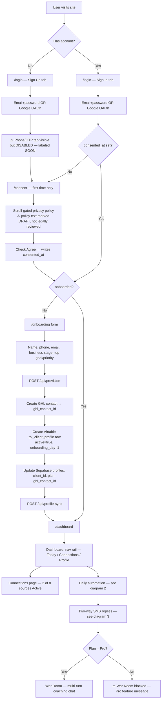
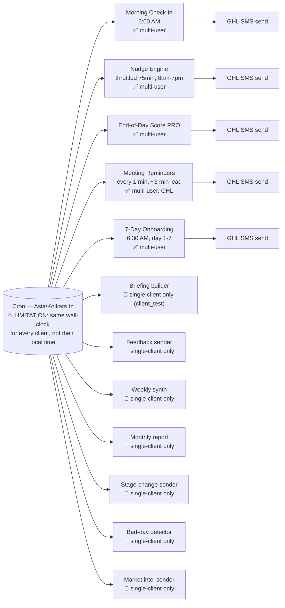
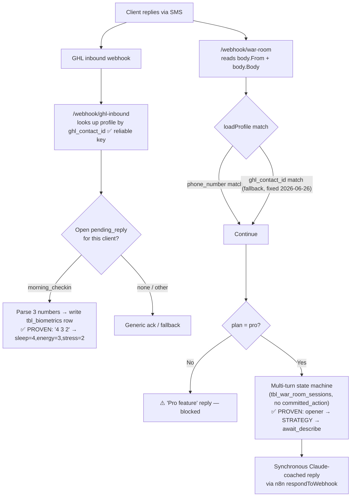

# Relentless AI — End-to-End Flow (web app + automation), 2026-06-26

How a user goes from "never heard of this" to receiving daily coached SMS, with every gap called
out inline (look for 🔴 NOT BUILT / ⚠️ LIMITATION) right where it happens — not as a footnote.

## 1. Master diagram

## 2. Daily automation — who sends what, and who's still single-client

All five ✅ senders loop every `{active}=1` Airtable profile and skip any client missing a
`ghl_contact_id` — so a real signup is picked up automatically next cycle, no manual step.
The 🔴 senders still only run for `client_test` — fine for the CEO demo, but **any other signed-up
user will not receive briefings, feedback, weekly/monthly reports, stage-change messages, bad-day
check-ins, or market intel** until those are fanned out the same way.

## 3. Two-way (inbound SMS reply) flow

⚠️ **War Room's phone-only match was a real bug** until today: if GHL forwarded a phone number
formatted differently than Airtable's `phone_number`, a paying Pro client would have been wrongly
told "Pro feature" mid-demo. Fixed by adding the `ghl_contact_id` OR-fallback (same key the main
router already trusted). Verified live with a blank/mismatched phone + correct `ghl_contact_id`.

## 4. Step-by-step narrative

### A. First-time visitor
1. Lands on `/login`. Sign Up tab: email + password, or "Continue with Google" (OAuth — works).
   🔴 **NOT BUILT**: phone-number / OTP sign-in tab is present in the UI but disabled, labeled "SOON".
2. After signup, **every** new session is forced through `/consent` first — `proxy.ts` middleware
   redirects any authenticated user without `consented_at` set, even if they try to jump straight
   to `/dashboard`.
3. `/consent`: must scroll the full privacy policy before the "I Agree" checkbox unlocks.
   ⚠️ **LIMITATION**: the policy text is explicitly marked DRAFT in the code — Florida jurisdiction,
   retention periods and SMS opt-out language are drafted but **not legally reviewed**.
4. Agreeing writes `consented_at` to the user's Supabase metadata, then routes to `/onboarding`
   (first-timer) since `onboarded` isn't set yet.

### B. Onboarding → provisioning (the "magic" step)
5. `/onboarding` form collects name, phone, email, business stage, top priority/goal.
6. On save, three things fire in sequence, all server-side, fully automatic:
   - `POST /api/provision` — idempotent. Creates a GHL contact (→ `ghl_contact_id`), creates an
     Airtable `tbl_client_profile` row (`active=true`, `onboarding_day=1`, plan, business stage,
     goal), and updates the Supabase `profiles` row with `client_id` + `airtable_base_id` +
     `ghl_contact_id` + `plan`.
   - `POST /api/profile-sync` — reconciles dashboard-facing fields.
   - Redirects to `/dashboard`.
7. From this point the user is a **real row** in the shared Airtable base (`appjnWxg9sB3PV7Da`,
   multi-tenant via `client_id`, not base-per-client — ⚠️ the original spec wanted base-per-client
   isolation; this was a deliberate trade-off for faster multi-user rollout) and will be picked up
   automatically by the five fanned-out senders on their next cron tick.
   - 🔴 **NOT BUILT**: per-client timezone-aware scheduling. All cron jobs fire on `Asia/Kolkata`
     wall-clock time. A US-based client gets their "6 AM morning briefing" at whatever hour that is
     in India, not 6 AM their time, until per-timezone cron lands.

### C. Returning sign-in
8. `/login` Sign In tab → email+password or Google OAuth.
9. `proxy.ts` sees `consented_at` already set → skip `/consent`.
10. `onboarding/page.tsx` sees `onboarded=true` → skip the form, go straight to `/dashboard`
    (unless the URL has `?edit=1`, which reopens the form pre-filled for editing).

### D. Dashboard (`/dashboard`)
11. Nav rail: Today (main view) / Connections / Profile.
12. Main view shows recurring tasks, the daily Executive Score (once EoD has run at least once),
    and a 90-day trend chart.
    ⚠️ Capital/Risk widgets that appeared in earlier spec drafts were intentionally removed —
    not a bug, a scope cut.
13. **Connections page** — "2 of 8 sources live": Recovery & Energy (wearable/manual biometric
    check-in) and Market Intelligence are Active; Calendar, CRM, Email, Slack, Sales Dashboard,
    LinkedIn all show "Coming soon" with a waitlist button.
    🔴 **NOT BUILT**: the 6 "soon" integrations have no OAuth flow at all yet — clicking shows an
    honest "coming soon" alert, no fake connect button (deliberate, to avoid a broken demo).

### E. Daily automation (once provisioned)
14. **Morning Check-in** (6:00 AM cron) — briefing-style SMS via GHL, fanned out to every active
    client with a `ghl_contact_id`.
15. **Nudge Engine** — checks every cycle (75-min throttle, 8am–7pm window), sends a contextual
    nudge via Claude + GHL if in-window and gated open.
16. **End-of-Day Score (Pro)** — computes a composite score (Body/Focus/Execution/Alignment),
    writes a `tbl_daily_scores` row, sends the score via GHL if `ghl_contact_id` present.
17. **Meeting Reminders** — polls every minute, fires ~3 minutes before any Supabase `meetings`
    row, dedup'd via `reminder_sent_at`.
18. **7-Day Onboarding** — separate daily themed welcome message (Day 1–7), auto-starts at
    `onboarding_day=1` (set by provisioning) and increments after each send.
19. 🔴 The remaining seven sender types (briefing builder, feedback, weekly synth, monthly report,
    stage-change, bad-day detector, market intel) are still hardcoded to `client_test` only — they
    do **not** fire for any other signed-up client yet.

### F. Two-way replies
20. Client texts back. GHL forwards inbound to `/webhook/ghl-inbound`, which resolves the sender by
    `ghl_contact_id` (robust — survives phone-number formatting differences).
21. If there's an open "pending reply" (e.g. morning check-in awaiting 3 numbers: sleep/energy/
    stress), the reply is parsed and written straight into `tbl_biometrics`. Proven live: `"4 3 2"`
    → `manual_sleep_input=4, manual_energy_input=3, manual_stress_input=2`.
22. **War Room (Pro only)**: a separate webhook (`/webhook/war-room`) reads GHL's raw `From`/`Body`
    fields directly (different shape than the main router). Gates on `plan==='pro'`; non-Pro users
    get an "this is a Pro feature" reply. Pro users enter a multi-turn coached conversation
    (PROBLEM / OPPORTUNITY / STRATEGY branches) backed by a session row in
    `tbl_war_room_sessions`, replying synchronously via n8n's `respondToWebhook`.
    ⚠️ As covered in diagram 3, this endpoint's client lookup is `phone_number`-first with a
    `ghl_contact_id` fallback added today — the fallback is new and should get a second look after
    the CEO demo.

## 5. Summary of everything flagged as missing/limited

| Area | Status |
|---|---|
| Phone/OTP login | 🔴 UI present, disabled, "SOON" |
| Legal review of consent/privacy text | ⚠️ Draft only |
| Per-client timezone scheduling | 🔴 Not built — all cron is India-time |
| Calendar / CRM / Email / Slack / Sales / LinkedIn integrations | 🔴 Not built — "Coming soon" placeholders |
| Briefing / feedback / weekly / monthly / stage / bad-day / market senders | 🔴 Single-client only, not fanned out |
| Airtable as the data layer | ✅ **Retired 2026-08-06** — migrated to Supabase after the API billing quota was exhausted (total outage from Jul 23). Zero Airtable nodes remain in n8n. |
| Base-per-client isolation (spec'd) vs shared base + client_id (built) | ✅ Moot — Airtable is gone; Supabase RLS now scopes rows per client |
| War Room phone-matching robustness | ⚠️ Fixed today with `ghl_contact_id` fallback — re-verify after demo |
| Wearable auto-sync (vs manual biometric entry) | ⚠️ Manual entry works; auto-sync deferred, not a current priority per user |
